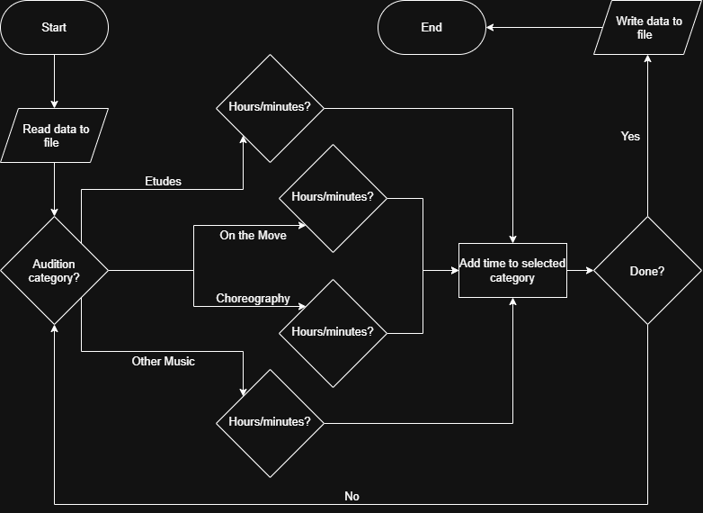

# audition-tracker

An command line tool that tracks time spent practicing certain categories of a drum corps audition.

## The Problem

There are many different parts to a drum corps audition, 
and it's difficult to not prioritize one over another too much.

## How It Works

The audition tracker allows a user to track their time spent practicing an audition
across four separate categories. The user selects one of the categories and adds
an amount of time in hours and minutes that they spent practicing that day. The
data can then export to a file, which the program can read the next time it is opened.

## Tech Stack

- **Language:** Java

## Setup

Work in progress

## Usage

Work in progress

## Roadmap

- [ ] Multiple users/accounts
- [ ] Track dates of specific practice sessions
- [ ] Handling specific edge cases

## Author

Hunter Doke, [github.com/HunterDoke](github.com/HunterDoke)
